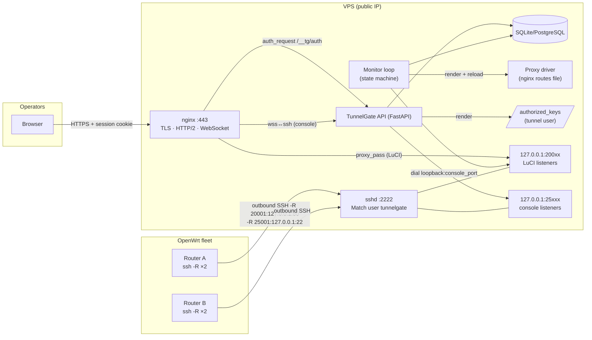
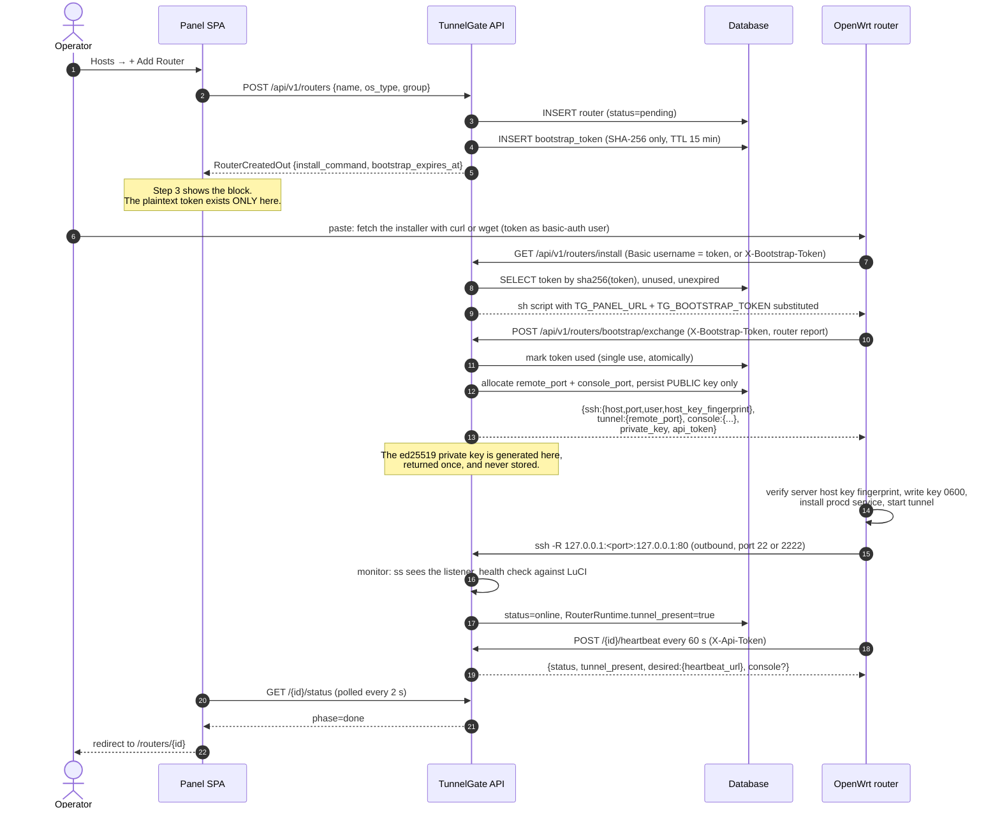
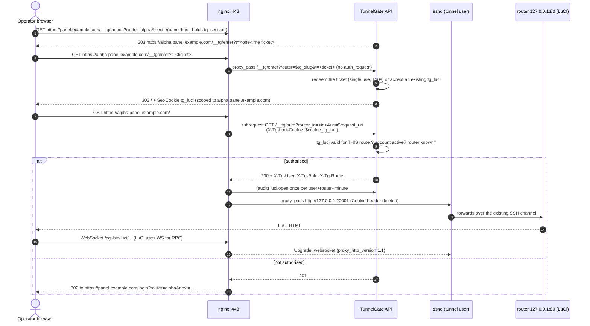
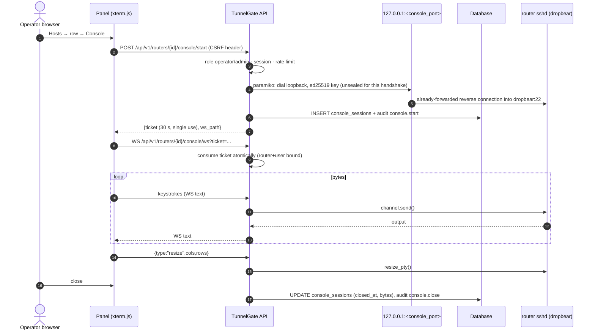
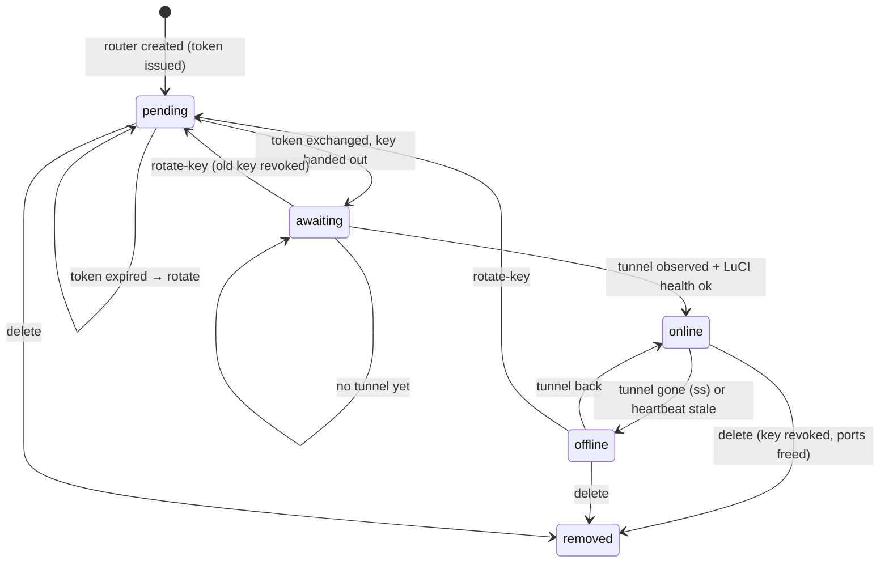
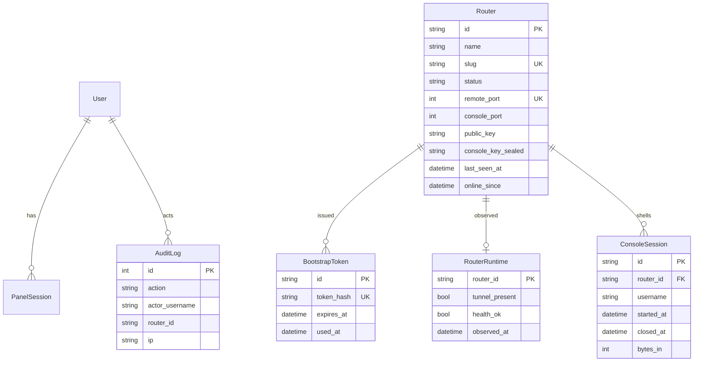

# TunnelGate architecture

> Centralised, authenticated access to the LuCI web UI **and** a shell on a fleet of OpenWrt
> routers, without exposing a single inbound port on any router and without giving the VPS a
> copy of any router's private key.

## 1. The problem

An OpenWrt fleet usually lives behind CGNAT, dynamic IPv4, or a carrier firewall. Reaching
`http://192.168.1.1` per router is impossible from outside, and port-forwarding on the router
is both fragile and wrong (it publishes LuCI to the internet, which is exactly what
[CVE-2018-10110-style scanner traffic](https://attack.mitre.org/) hunts for).

The classic fix is a reverse SSH tunnel. Doing that *by hand* for 100+ routers means
hand-managing keys, ports and `authorized_keys` lines; doing it *safely* additionally requires
that a compromised router cannot pivot into the VPS, that a leaked install command cannot be
replayed, and that the operator can prove who opened which router's UI and when.

TunnelGate automates all of it:

* the router dials **out** to the VPS over SSH and asks the VPS to open a listener that feeds
  back into the router's own `127.0.0.1:80`;
* the VPS reverse-proxies `https://<slug>.<domain>` to that listener and demands a panel
  login before it lets anyone through;
* onboarding is a one-liner that contains a **single-use, 15-minute token** and nothing else -
  no key, no port, no secret.

## 2. Planes



Two independent planes meet at the panel:

* **Control plane** - HTTPS/JSON API and the SPA. Carries operator identity, router inventory,
  bootstrap tokens, status, audit.
* **Data plane** - SSH reverse tunnels. Carries the actual LuCI HTTP traffic and the console
  shell bytes. The panel never proxies LuCI itself: nginx does, so a 30 MB firmware download
  through LuCI does not touch the Python process.

## 3. Why a reverse tunnel and not WireGuard/Tailscale/Cloudflare

| Option | Verdict |
|---|---|
| **SSH reverse tunnel** (chosen) | No kernel modules, no accounts, no third party. The forward-only `authorized_keys` line makes each router's reach *provably* limited to one port, and `ss`/journalctl give a ground-truth answer to "is it up?". |
| WireGuard | Faster, but every router needs a tunnel address, a route, and the VPS becomes an L3 router for the whole fleet. A compromised router is inside your network. |
| Tailscale / headscale | Excellent ergonomics, but requires a third-party control plane (or self-hosted DERP) and hands every router a routable identity - a much larger blast radius than "may open one TCP listener". |
| Cloudflare Tunnel | Requires an external account per router, and the local service is a `cloudflared` binary that does not exist in OpenWrt's package feeds for most targets. |

## 4. Onboarding sequence (first install)



### Why the token lives in the script and not in the URL

A URL lands in nginx access logs, in shell history, and in `ps` output while the fetcher runs.
The script body does not. The script is served over TLS, substituted server-side, and carries
`Cache-Control: no-store`. The token is `secrets.token_urlsafe(32)` (256 bits), stored only as
SHA-256, single use, 15 minutes.

The fetch itself is the one place where the token *is* visible on the router: no stock OpenWrt
image ships `curl`, and its `/usr/bin/wget` is a symlink to `uclient-fetch`, which only
learned `--header` in 24.10. The only channel that exists on every generation is HTTP Basic
auth, so the token travels as the **basic-auth username** (`--user="$TK"`, and `-u "$TK:"` for
curl). It is therefore an argument in the router's shell history - which is why it is single use
and expires in 15 minutes. See [INSTALL_ROUTER.md §2](INSTALL_ROUTER.md) for the measured
detail and the placeholder password that keeps `uclient-fetch` from dropping the colon.

## 5. Request path (operator opens LuCI)

### 5.1 Two ways to address a router

`TUNNELGATE_ROUTE_MODE` decides how a router is named, and the rest of this section describes
the default.

| | `subdomain` (default) | `path` |
|---|---|---|
| Router URL | `https://alpha.panel.example.com/` | `https://gate.example.com/alpha/` |
| DNS | wildcard `*.panel.example.com` | one record for the gateway host |
| Certificate | wildcard (`*.panel.example.com`, DNS-01 only) | ordinary certificate for the gateway host |
| Driver | nginx or caddy | nginx only |
| Generated by | one `server` block per router | one `server` block for the gateway, or a plain set of `location`s when the gateway is the panel's own host or TLS terminates in front of a plain-HTTP nginx ("Path mode: separate and merged layouts" below) |
| Cookie scope | host-only `tg_luci` on the router host | `tg_luci` with `Path=/alpha/` |
| Origin | the router's own host | the gateway host - which is also the panel origin in the merged layout |

**Why path mode exists.** A wildcard certificate needs DNS-01 and a zone you control, and a
free dynamic-DNS name (or a bare IP for the panel) cannot carry `<slug>.<suffix>` at all - an IP
can only ever be the *whole* host, so a browser refuses `https://alpha.192.168.88.107/`
outright. Path mode needs no wildcard and no per-router DNS: every router is served from the one
gateway host, and the router is the first path segment.

#### Path mode: separate and merged layouts

The console always keeps its own name. The gateway itself has two layouts, and the panel picks
one by comparing `TUNNELGATE_GATEWAY_HOST` with `TUNNELGATE_PANEL_HOST`:

| | **separate** (gateway != panel host) | **merged** (gateway == panel host) |
|---|---|---|
| `routes.conf` holds | one full `server` block for the gateway, plus `map $http_upgrade $tg_connection_upgrade` | only `location`s: `/__tg/auth` (internal), `@tg_login`, `/<slug>/__tg/enter`, `/<slug>/`, `= /<slug>` (308) |
| Included in | the nginx **http** context, as before | the **panel `server` block** |
| Panel reachable at | `panel.example.com` | the same host, so `/` must stay the panel |
| Origin separation | yes - router content is a different origin | **no** - router content shares the panel origin |

The separate layout is the recommended one and the default whenever the two names differ: a
router page then cannot touch the panel's own DOM or origin. The merged layout exists for
deployments with exactly one usable public name - a free dynamic-DNS name with no wildcard, or a
single-certificate install - and pays for that with origin isolation: anything a router serves
runs in the panel's origin and can act with the operator's session. docs/SECURITY.md §6.1 states
the trade-off in full; read it before choosing merged. `app.cli doctor` reports which layout the
configuration produces, warns on merged, and still fails a gateway that is an IP, has no dot, or
is empty.

The include has to move with the layout, and nginx is blunt about it: a file of bare `location`
blocks in the http context fails `nginx -t` with `"location" directive is not allowed here`, and
the reverse mistake fails the same way (`"server" directive is not allowed here` when a
separate-layout file is included inside a server block). Nothing is silently mis-served, but
nothing boots either - and the error names `routes.conf:1`, not the vhost that included it, so
it reads like a bug in the generated file. Doctor pins it down under `routes include`: it runs
`nginx -t` and, when the parse fails, tells you which context the current layout wants. In the
merged layout the panel vhost looks like this:

```nginx
server {
    server_name gate.example.com;
    ...
    include /etc/nginx/tunnelgate/routes.conf;
    location / {
        proxy_pass http://127.0.0.1:8080;
        ...
    }
}
```

and the panel vhost must define the upgrade map itself, in the http context: a `map` is
illegal inside a `server` block, so the merged file cannot carry one, and its router locations
reference `$connection_upgrade` - the same target the panel vhost already declares for its own
WebSocket. Leave that map out and `nginx -t` stops with `unknown "connection_upgrade"
variable`; declare it twice and the later definition silently wins, so keep one:

```nginx
map $http_upgrade $connection_upgrade {
    default upgrade;
    ''      close;
}
```

Merging the two namespaces has an operational consequence that has nothing to do with TLS: the
router prefixes now compete with the panel's own paths on one host, and a router's `location` is
more specific than the panel's `location /`. Where the collision is with a location the panel
vhost declares (`/api/`, `/assets/`) nginx rejects the whole config - `duplicate location`;
where it is with an SPA route (`/login`, `/hosts`, `/settings`, `/audit`, `/routers`) the config
parses and the page is silently shadowed, which for a router called `login` means the sign-in
page redirects into the router prefix and back, forever. Nothing reserves those slugs today, so
a fleet is renamed before it is switched, not after; docs/INSTALL_SERVER.md, Option C lists the
affected names. The separate layout has no shared namespace and no such rule.

**A third shape: separate on a plain-HTTP hop.** When the nginx this panel renders into serves
plain HTTP to the operator's TLS-terminating proxy - `TUNNELGATE_PROXY_PLAIN_HTTP=true`, which is
what `scripts/quick-install.sh --gateway-host` writes - the gateway is still a separate origin,
but its `server` block cannot live in `routes.conf` either: the panel rewrites that file
whenever the router or port set changes, so a listen port written into it would be lost on the
next render, and no setting names that port. The renderer therefore emits locations only, exactly
as the merged layout does, and the gateway vhost the installer writes
(`deploy/nginx/tunnelgate-gateway-behind-proxy.conf`) includes the file **inside** its own
`server` block on the same plain port as the panel vhost - so one listener answers both names and
the operator's proxy only has to route by name. `$connection_upgrade` still comes from the panel
vhost, since a `map` is http-context only. The one mistake to avoid in this shape is including
`routes.conf` from the *panel* vhost as well: it parses, it works, and it puts every `/<slug>/`
back on the panel's origin - which is why the installer replaces that include with a comment in
this layout, and why `doctor`'s `routes include` message names the gateway vhost.

**The cost.** A router's LuCI is written as if it owned a host. Its HTML contains absolute links
(`/cgi-bin/luci/...`), its redirects are absolute paths, and its cookies are `Path=/`. In path
mode the generated gateway block therefore:

- routes `/<slug>/` to that router's tunnel port and strips the prefix with a trailing-slash
  `proxy_pass`;
- rewrites `href="/`, `src="/` and `action="/` in the response body with `sub_filter`
  (which is why the upstream is asked for an uncompressed body: `proxy_set_header
  Accept-Encoding ""`);
- rewrites `Location:` headers with `proxy_redirect` and narrows each `Set-Cookie` path
  with `proxy_cookie_path / /<slug>/`;
- answers `/<slug>` with a 308 to `/<slug>/`;
- and, in the separate layout only, answers everything else on the gateway host with 404 - there
  is no panel there. The merged layout defines no `location /` at all, so `/` stays whatever the
  panel vhost already had.

All of that needs `sub_filter`, so the nginx build must carry `--with-http_sub_module`; doctor
reports it as `sub_filter module` and fails when the server binary was built without it (the
distro `nginx` package includes it).

Anything the panel cannot see (JavaScript that builds URLs at runtime, a LuCI app that hard-codes
a base path) can still escape the prefix; subdomain mode has no such gap. That is why subdomain
mode remains the default and why switching is a deliberate act, not a fallback. In the merged
layout the escape is worse than a broken link: the prefix is not an origin boundary, so a LuCI app
that escapes it is scripting the panel's own origin - docs/SECURITY.md §6.1.



Four properties matter here:

1. **The router's ID is bound in nginx, not in a header.** Each generated `server` block contains
   `set $tg_router '<id>';` and the shared auth location forwards it as a query parameter. The
   browser cannot influence which router it is being authorised for, so a valid credential
   cannot be replayed against a different router by editing a URL.
2. **The credential is scoped to the host it is used on.** The operator is signed in on
   `panel.example.com`; `alpha.panel.example.com` is a different host, so the panel session is
   not sent there - and a domain-wide cookie is not needed to change that. The hand-off
   (steps 1-6) exchanges the panel session for a one-time ticket, redeems it *through the
   router vhost* so the resulting `tg_luci` cookie is set on that router's hostname, and
   `tg_luci` names that one router and expires in an hour. Widening `tg_session` to the
   whole domain is still not part of a correct deployment.
3. **Exactly one cookie reaches the auth subrequest, and none reaches the router.** The snippet
   forwards `$cookie_tg_luci` in a dedicated header rather than `$http_cookie`, so nothing else
   the browser holds can influence the gate; the proxied request carries
   `proxy_set_header Cookie "";`, so LuCI sees neither cookie.
4. **Fail closed.** `auth_request` treats anything but a 2xx as "deny" and `error_page 401`
   redirects to the panel login. If the panel is down, the router UIs are unreachable rather
   than open. `/__tg/enter` is the one location outside `auth_request`, and it fails closed
   too: an expired, replayed, wrong-router or wrong-host ticket redirects to the login page.

**In path mode** steps 1 and 2 look different, and the four properties above still hold:

```mermaid
sequenceDiagram
    autonumber
    actor OP as Operator browser
    participant NG as nginx :443 (gate.example.com)
    participant API as TunnelGate API

    OP->>NG: GET /__tg/launch?router=alpha&next=/
    NG->>API: proxy_pass (this location lives on the PANEL host)
    API-->>OP: 303 https://gate.example.com/alpha/__tg/enter?t=<ticket>
    OP->>NG: GET /alpha/__tg/enter?t=<ticket>
    NG->>API: location = /alpha/__tg/enter  (sets $tg_router, $tg_slug; no auth_request)
    API->>API: redeem the ticket; resolve the router from X-Original-URI, not from a Host
    API-->>OP: 303 /alpha/  +  Set-Cookie tg_luci (Path=/alpha/)
    OP->>NG: GET /alpha/cgi-bin/luci
    NG->>API: subrequest /__tg/auth?router_id=<id>&uri=/alpha/cgi-bin/luci
    API-->>NG: 200 (tg_luci valid for this router)
    NG->>NG: proxy_pass http://127.0.0.1:20001/   (prefix stripped, Host: alpha)
    NG-->>OP: LuCI HTML with href="/alpha/cgi-bin/luci" rewritten
```

The binding property becomes: **the router's ID is bound in the `location`, and the panel
resolves the router from `X-Original-URI` rather than from the `Host` header.** A visitor can
edit the path, but the path *is* the routing decision - it selects a different `location` whose
own `$tg_router` is fixed at render time, and the ticket and `tg_luci` are both checked against
that same router id. Editing `/alpha/...` to `/beta/...` does not re-authorise anything: the
gate sees `tg_luci` for alpha and a request claiming beta, and refuses.

The diagram is the merged layout: `gate.example.com` is the panel host, so `/__tg/launch` and
`/alpha/...` are locations of the same `server` block and the browser sees one origin. In the
separate layout the panel keeps its own vhost: step 1 runs on `panel.example.com` and redirects to
`https://gate.example.com/alpha/__tg/enter?t=<ticket>`, with the gateway `server` block coming
from `routes.conf`. Nothing else changes - the four properties hold in both. What differs is what
a compromised router can reach: in the merged layout, the panel's origin.

The `tg_luci` cookie is narrowed to `Path=/<slug>/`, so it is never sent to the panel, to
another router's prefix, or to the gateway root. The panel hop still drops `Cookie` entirely
(`proxy_set_header Cookie "";`), so LuCI sees neither the panel session nor the router cookie.

## 6. Console sequence (web shell)

The console inverts the direction: the panel authenticates **to the router**.



The console key pair is created **lazily** (the first time somebody opens a console), and its
private half is sealed with AES-256-GCM under `TUNNELGATE_SECRET_KEY`. The router only ever
receives the public half, through the heartbeat response, and installs it in its own
`/etc/dropbear/authorized_keys`. See [SECURITY.md](SECURITY.md#console-key-material).

## 7. Router state machine



* **online** is not a boolean the router reports; it is observed. The monitor runs
  `ss -Hltn` once per cycle, and only ports that actually have a *listening socket owned by the
  tunnel user* are then health-checked with an HTTP GET against LuCI. Any 2xx/3xx/401 counts as
  alive (401 = "LuCI is asking for credentials", which means LuCI is up).
* The heartbeat is **advisory only**: it refreshes metadata (firmware version, model, uptime)
  and delivers console key registrations. It can never mark a router online on its own.
* The one thing it *does* decide is where the router dials next. `desired.heartbeat_url` is
  built from the agent endpoint (an admin-editable database override, else
  `TUNNELGATE_PANEL_URL` - see [API.md](API.md#settings-admin-only-csrf)) and the agent adopts
  it verbatim when it differs from its own UCI setting. That is the only way an operator can
  move the panel to a new hostname or port without re-running the installer on every device in
  the field, and it is why the panel's internal address and the address routers use are two
  separate settings rather than one.
* `stale_offline_seconds` (default 90) covers the case where `ss` is unavailable: a router whose
  heartbeat stopped is demoted to offline.

## 8. Port management

Two independent pools, both loopback-only:

| Pool | Default range | Purpose |
|---|---|---|
| tunnel | `20000-25000` | LuCI listener per router |
| console | `25001-30000` | shell listener per router |

`allocate_port()` runs under a process-wide lock (SQLite has no advisory locks), skips ports
already present in `routers.remote_port` / `routers.console_port`, and additionally binds the
candidate port to confirm nothing else on the host owns it. Ports are **never** recycled while
a `revoked`/deleted router's `authorized_keys` line could still be live; deletion revokes the
key first, then frees the port.

## 9. Data model



## 10. Technology choices

| Choice | Why | Cost |
|---|---|---|
| **FastAPI + SQLAlchemy 2.0 (sync)** | The workload is I/O-light CRUD plus one background loop; sync ORM is simpler to reason about than async sessions, and FastAPI still gives async endpoints where it matters (WebSocket bridge, monitor). | Sync DB calls run in the threadpool. |
| **SQLite (WAL) by default** | Zero-ops VPS install; `create_all` instead of a migration framework for a greenfield schema. | Single writer; fine for 100s of routers and a handful of operators. PostgreSQL is supported by changing `TUNNELGATE_DB_URL`. |
| **nginx as the proxy driver** | Mature WebSocket support, `auth_request` is exactly the primitive needed, and the generated config is auditable text. Caddy driver exists for people who prefer automatic TLS. | Requires a reload per route change (hash-guarded). |
| **Vite + React + TypeScript SPA** | The wizard has real client state; a SPA keeps the API honest and the bundle small (no SSR server to secure). | One extra build step in the image. |
| **xterm.js** | The de-facto browser terminal; handles VT sequences and resize properly. | Another frontend dependency. |
| **paramiko** | Pure-Python SSH client, no system `ssh` binary needed in the container, fully testable. | Slower than a native client (irrelevant at human typing speeds). |
| **stdlib scrypt** | No bcrypt/argon2 dependency; `n=2^14` is ~100 ms, enough for a login form guarded by rate limiting. | Not memory-hard enough for offline cracking of a leaked DB; documented in SECURITY.md. |

## 11. Scaling to 100+ routers

* One SSH connection per router costs ~1 process (`sshd -R`) and a few hundred KB. 500 routers
  is ~1 GB of sshd processes and 500 loopback listeners - comfortable on a 2 vCPU / 4 GB VPS.
* The monitor polls with a **single** `ss` invocation per cycle and health-checks only listening
  ports, with a bounded concurrency of 16; a dead router costs one 3 s timeout at most.
* The panel list endpoint is paginated and returns counters from one aggregate query; the SPA
  polls at 5 s only while the tab is visible.
* nginx reloads are hash-guarded: a cycle where nothing changed does not touch nginx.

## 12. Failure modes

| Failure | Behaviour | Recovery |
|---|---|---|
| Router offline (power/network) | tunnel disappears, `ss` no longer lists the port → status offline within one cycle | router's procd respawns ssh; status returns to online automatically |
| SSH connection drops but process alive | `ServerAliveInterval 30` kills the ssh within 90 s | procd respawn |
| VPS reboots | tunnels and nginx routes are rebuilt from the DB on boot (`ensure_dirs` + initial `proxy.reload()`); routers reconnect within their respawn interval | automatic |
| Panel process dies | `auth_request` fails closed → router UIs unreachable (safe), systemd restarts the app | automatic |
| nginx config render fails | the old config stays; `ProxyManager.last_error` surfaces in `/api/v1/stats` | fix and reload |
| Key compromised | rotate-key: new key, old key revoked immediately, ports retained | operator action |
| Bootstrap token leaked | valid for ≤15 min, single use, and only ever buys a tunnel into the *named* router | delete + rotate |
| Port exhausted | `503 no_free_port` with a clear error | widen the range |

## 13. Related documents

* [SECURITY.md](SECURITY.md) - threat model, key restrictions, the `restrict`+ `permitlisten` trap.
* [API.md](API.md) - the frozen REST surface.
* [INSTALL_SERVER.md](INSTALL_SERVER.md) - VPS bring-up (DNS, TLS, sshd, firewall, systemd), plus
  running behind a reverse proxy or load balancer and moving the panel without re-installing routers.
* [INSTALL_ROUTER.md](INSTALL_ROUTER.md) - the router side.
* [OPERATIONS.md](OPERATIONS.md) - runbooks: add/rotate/delete, incident response, backups.
* [UI.md](UI.md) - panel screens, wizard state machine, accessibility notes.
